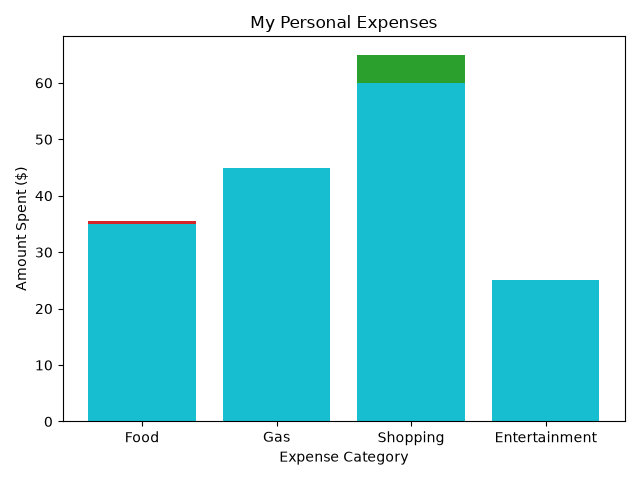

# Personal Expense Tracker

## Project Overview
This is a Python project I created to help track and analyze personal spending. The program allows users to enter their expenses, calculate their total spending, and see which categories they spend the most money on.

## Features
- Enter expenses for food, gas, shopping, and entertainment
- Calculate total expenses automatically
- Calculate the percentage spent in each category
- Display spending using a bar chart
- Save expense data to a CSV file that can be opened in Excel
- Identify the highest spending category

## Technologies Used
- Python
- Matplotlib
- CSV
- Microsoft Excel

## How to Run
1. Open `expense_tracker.py` in Python or Positron.
2. Run the program.
3. Enter your spending amounts when prompted.
4. View your total expenses and spending percentages.
5. View the bar chart and saved CSV file.

## What I Learned
Through this project, I practiced Python programming, working with user input, performing calculations, creating data visualizations, and exporting data to CSV files.
## Expense Visualization

The chart below shows an example of spending across four categories: food, gas, shopping, and entertainment.

